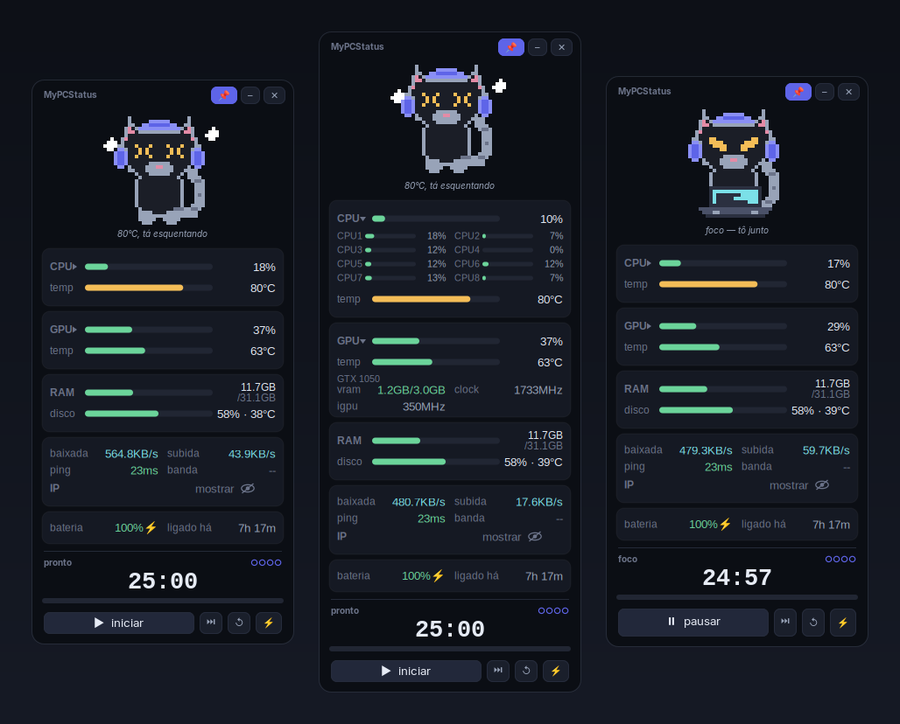
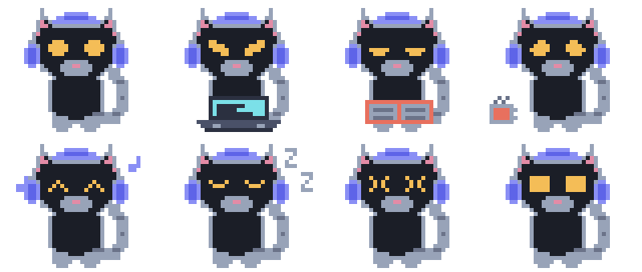
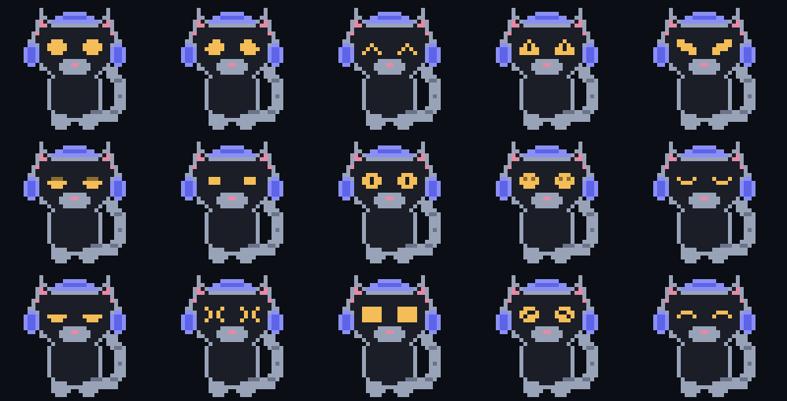

<div align="center">

# MyPCStatus

**Um gato pixel art que mora no canto da tela e te conta como o PC está.**




</div>

---

CPU, GPU, RAM, temperatura, rede, disco e bateria numa janelinha sem borda que
fica sempre no topo, agrupadas em cards — com um pomodoro embaixo e um gato que
**reage ao que está acontecendo**. Se a máquina esquenta, ele sua. Se o pomodoro começa, ele senta
no notebook. Se tudo está quieto, ele dorme.

Não instala nada: usa só o que já vem numa distro GTK 3 com Python.

## O que ele mostra

| Métrica | Detalhe |
|---|---|
| **CPU** | média dos núcleos, suavizada em 3 amostras. Clique na linha e ela abre com cada núcleo separado |
| **RAM** | usada / total |
| **Temperatura** | `coretemp` → `k10temp` → `acpitz`, nessa ordem; se nenhum existir, pega o sensor mais quente que fizer sentido |
| **GPU** | uso, temperatura, VRAM e clock. Clique na linha e ela abre com os detalhes e a GPU integrada |
| **Rede** | taxa de download/upload lida dos contadores do kernel + ping a cada 10 s |
| **Disco** | uso de `/` e temperatura do NVMe |
| **Bateria** | percentual, carregando ou não |
| **Banda** | teste real sob demanda, só quando você clica no ⚡ |
| **IP público** | sob demanda, oculto por padrão, com botão de copiar |

O teste de velocidade **nunca roda sozinho**. O resto é tão barato que a janela
inteira custa menos CPU que uma aba de navegador parada.

## O mascote

<div align="center">





</div>

Quinze expressões e oito poses, todas desenhadas pixel a pixel. Ele pisca em
intervalos aleatórios e "respira" — o corpo sobe e desce um pixel.

A pose sai do estado real da máquina, em ordem de prioridade:

| Quando | O que ele faz |
|---|---|
| temperatura ≥ `temp_crit` | sua frio, olhos `>_<` |
| GPU ≥ `gpu_temp_crit` | sua frio também |
| pomodoro em foco | senta no notebook |
| pausa curta | toma café |
| pausa longa | lê um livro |
| CPU ≥ 88% ou RAM ≥ 90% | arregala os olhos |
| GPU ≥ 95% de uso | arregala os olhos |
| temperatura ≥ `temp_warn` | começa a suar |
| GPU ≥ `gpu_temp_warn` | começa a suar |
| disco ≥ 90% | olhar curioso, sugere uma limpada |
| nada acontecendo | alterna a cada 24 s entre parado, ouvindo música, notebook, livro e café |
| CPU < 6% e parado | dorme, com Zzz |

## Instalar

```bash
git clone https://github.com/yjdutra/MyPCStatus.git
cd MyPCStatus
./run.sh
```

Gostou? Registra no menu de aplicativos:

```bash
./install.sh
```

E, se quiser que ele suba junto com o sistema:

```bash
./install.sh --autostart
```

### Requisitos

Python 3.10+, PyGObject (GTK 3), `psutil`, cairo. Em Ubuntu, Zorin, Mint e
derivados **já vem tudo instalado**. Se faltar algo:

```bash
sudo apt install python3-gi python3-psutil python3-cairo gir1.2-gtk-3.0
```

Opcionais, para ícone de bandeja e notificação: `gir1.2-ayatanaappindicator3-0.1`,
`libnotify-bin`.

## Usar

| Ação | Como |
|---|---|
| Mover | arraste pelo cabeçalho **ou pelo próprio gato** |
| Abrir os núcleos | clique na linha `CPU` |
| Abrir os detalhes da GPU | clique na linha `GPU` |
| Ver o IP público | clique no olho, no card de rede |
| Copiar o IP | clique no ícone ao lado dele |
| Menu | botão direito no gato |
| Sempre no topo | botão 📌 |
| Esconder na bandeja | botão `–` |
| Pomodoro | `▶` inicia, `⏭` pula a fase, `↺` zera |
| Testar a internet | botão `⚡` |
| Abrir de novo | traz a janela que já existe para a frente, não abre uma segunda |

A posição da janela é gravada sozinha quando você solta o arraste.

## Configurar

Fica em `~/.config/mypcstatus/config.json`, criado na primeira execução.
Feche o app antes de editar — ele regrava o arquivo ao sair.

| Chave | Padrão | O que faz |
|---|---|---|
| `x`, `y` | auto | posição na tela (`-1` = canto superior direito) |
| `scale` | `4` | pixels de tela por pixel do desenho (3 = menor, 5 = maior) |
| `opacity` | `1.0` | 0.85–0.95 deixa o fundo transparecer |
| `keep_above` | `true` | sempre no topo |
| `cpu_smooth` | `3` | amostras na média móvel da CPU (`1` desliga) |
| `cpu_expanded` | `false` | já abre com os núcleos à mostra |
| `gpu_expanded` | `false` | já abre com os detalhes da GPU à mostra |
| `focus_min` | `25` | minutos de foco |
| `short_min` | `5` | pausa curta |
| `long_min` | `15` | pausa longa |
| `cycles` | `4` | focos até a pausa longa |
| `autostart_timer` | `false` | já começa contando ao abrir |
| `sound` | `true` | som na virada de fase |
| `temp_warn` | `75` | °C em que o gato começa a reclamar |
| `temp_crit` | `85` | °C em que ele entra em pânico |
| `gpu_temp_warn` | `80` | idem para a GPU, que trabalha mais quente |
| `gpu_temp_crit` | `90` | idem |

## Como funciona

```
mypcstatus/
  art.py        o desenho: paleta, corpo do gato, 15 expressões, acessórios
  sprite.py     compõe corpo + pose + expressão num grid de caracteres
  mascot.py     desenha e anima o sprite; decide a pose pelas métricas
  metrics.py    coleta CPU/RAM/temperatura/rede/disco/bateria
  gpu.py        leitura de GPU, um backend por fabricante
  pubip.py      descobre o IP público, sob demanda
  pomodoro.py   máquina de estados do timer
  speedtest.py  teste de banda sob demanda
  widgets.py    painel de métricas desenhado com cairo + pango
  window.py     a janela flutuante e a ligação de tudo
  tray.py       ícone de bandeja (opcional)
  gtkcompat.py  fixa as versões do GTK/Gdk antes de qualquer import
tools/
  make_icon.py   regera o ícone a partir do sprite
  make_sheets.py regera as folhas de expressões e poses
  screenshot.py  renderiza a janela direto para PNG, sem capturar a tela
```

Algumas decisões que valem explicar:

**GTK 3, não 4.** O GTK 4 removeu o `set_keep_above()` no X11 — justamente o que
um widget flutuante sempre-no-topo precisa.

**O tempo do pomodoro vem de `time.monotonic()`**, não da contagem de ticks. Se
a interface travar ou o timer da GLib atrasar, o relógio continua certo.

**O IP público não é buscado sozinho, e nasce oculto.** Descobrir o IP exige
perguntar a um terceiro, que então passa a saber dele — inevitável, mas não há
razão para fazer isso toda vez que o app abre. Então a consulta só sai quando
você clica no olho. E o valor fica mascarado até você mandar mostrar, para não
vazar em captura ou compartilhamento de tela. A resposta é validada como
endereço IP de verdade: portal cativo de wi-fi público devolve HTML com status
200, e sem a checagem isso viraria "IP". O botão ao lado copia para a área de
transferência, que é o caso de uso real — liberar o seu IP no firewall de um
provedor sem abrir um site de terceiro para descobri-lo.

**Cada GPU tem o seu backend**, porque o que dá para medir muda com o driver.
NVIDIA entrega tudo pelo `nvidia-smi`, mas custa ~16 ms por chamada porque sobe
um processo — então ela é lida numa thread a cada 2 s, nunca na thread da
interface. AMD publica `gpu_busy_percent` em sysfs, uso real e de graça. Já o
i915 da Intel **não expõe uso sem root** (precisa do PMU via perf): só dá para
ler a frequência, que é indício de carga e não uso. Nesse caso a barra mostra o
clock e o rótulo diz `MHz`, em vez de fingir que é porcentagem.

**Instância única pelo `Gtk.Application`.** O app registra um `application_id` no
barramento de sessão; abrir de novo manda um `activate` para quem já está
rodando e sai. Sem isso, o autostart mais um clique no menu dariam dois gatos
disputando o `config.json`.

### Mexer no desenho

O gato é um grid de caracteres, uma letra por pixel:

```python
BASE = [
    "............L............L..............",  # pontas das orelhas
    "...........LNL..........LNL.............",
    "..........LNNNL.bbbbbb.LNNNL............",  # arco do fone entre as orelhas
    ...
]
```

A legenda está em `PALETTE`. Para mudar uma expressão, edite o bloco de 5×4
dentro de `EYES`. Para criar uma pose, faça um stamp `(coluna, linha, grid)` e
registre em `POSES`. As expressões assimétricas, que precisam ser espelhadas no
olho direito, vão listadas em `MIRROR_EYES`.

Depois rode `python3 tools/make_icon.py` e `python3 tools/make_sheets.py` para
atualizar as imagens.

## Limitações conhecidas

- **Só X11.** No Wayland o GTK 3 não deixa o aplicativo posicionar a própria
  janela, então o `x`/`y` do config é ignorado e o "sempre no topo" depende do
  compositor. Foi feito e testado no Zorin OS 18 (GNOME/X11).
- O ícone de bandeja depende de uma extensão de AppIndicator. Sem ela, o app
  funciona igual — só não aparece na bandeja.

## Licença

MIT — veja [LICENSE](LICENSE).
